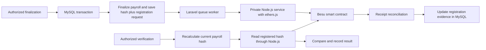

# Hyperledger Besu Payroll Integrity Integration Plan

Date: 2026-11-09

Status: Phases 1–5 implemented; Phase 6 pilot rollout pending.

Phase 1 deliverables (2026-11-09): [payroll integrity specification](besu-phase-1-specification.md) and [fixed SHA-256 vectors](besu-phase-1-hash-vectors.json). All three vectors were independently reproduced using Python and PHP. Runtime integration remains unchanged. Payment-release policy and production ownership remain business/deployment decisions.

Phase 2 deliverables (2026-11-09): separate `PayrollIntegrityRegistry.sol` contract, organization-scoped registrar permissions, immutable reference/revision registrations, and seven passing EVM test scenarios. ABI, governance limits, and test instructions are recorded in the [contract implementation section](besu-phase-1-specification.md#phase-2-contract-implementation). The registry is compiled and tested but not deployed or selected by Laravel; legacy anchors retain their current contract and driver.

Phase 3 deliverables (2026-11-09): implemented the private Node HTTP bridge, SQLite transaction journal, Web3Signer/ethers gateway, and recovery tests. Ethers.js 6.17.0 was approved and installed as an exact runtime dependency. All 27 core, gateway, and runnable-service tests passed, including signing/confirmation over actual ethers HTTP transport against a mock RPC server. See [bridge implementation notes](blockchain-anchoring.md#10-nodejs-registry-bridge-phase-3). A real network deployment/pilot remains; Laravel integration is implemented in Phases 4–5 below.

Phase 4 deliverables (2026-11-09): implemented opt-in atomic finalization/capture, the version 1 canonical serializer and fixed-vector validation, a durable MySQL registration outbox, a scheduled bounded dispatcher, leased queue processing, authenticated bridge synchronization, and confirmation/failure reconciliation. Initial registrations receive an opaque reference and revision 1. Legacy anchors keep their original algorithm and contract. Registry verification is implemented in Phase 5 below. The correction/revision user workflow has not been added; no production configuration, registry deployment, or live database migration was performed. See [Laravel integration instructions](blockchain-anchoring.md#11-laravel-finalization-and-registration-outbox-phase-4).

Phase 5 deliverables (2026-11-09): implemented authorized read-only registry verification, consistent current-data hashing, independent evidence/metadata checks, six distinct verification outcomes, timestamped audit history, and registry pages alongside legacy/simulated proofs. Verification remains available when capture is disabled or the signer is down, provided the original deployment can be read through the configured bridge. New verification logs require the additional migration. See [verification instructions](blockchain-anchoring.md#12-versioned-payroll-verification-and-pages-phase-5).

## Objective and scope

Extend the existing Laravel application with blockchain evidence of finalized payroll integrity. MySQL remains the payroll system of record and stores confidential employee and payroll details. Hyperledger Besu stores only a payroll reference, revision, SHA-256 digest, and necessary verification metadata.

Laravel owns payroll processing, authorization, finalization, canonical payload generation, hashing, and verification requests. A private Node.js service using ethers.js handles blockchain communication and transaction lifecycle management.

This plan is based on inspection of Laravel 13.40.0, the approval and blockchain services, the Solidity contract, and local network configuration. A running Besu network was not validated during planning.

## 1. Build on the existing integration

| Existing component | Planned change |
| --- | --- |
| Payroll submission, independent approval, and finalization | Trigger registration automatically after finalization |
| `BlockchainAnchorService` | Strengthen hash serialization and move submission outside database transactions |
| Direct Laravel-to-Besu driver using Web3Signer | Add the proposed Node.js/ethers.js bridge |
| Solidity contract storing registered hashes | Bind each hash to a unique payroll reference and revision |
| Anchor records, verification logs, and verification pages | Add automatic confirmation, recovery, and clearer verification states |
| Four-validator local QBFT configuration | Use for development; design production ownership and hosting separately |

The current contract records whether a hash exists but does not bind it to a payroll reference. The current finalization method does not automatically register payroll.

## 2. Integration flow



Keep payroll status and blockchain status separate. A payroll can be `FINALIZED` while registration is `QUEUED` or `SUBMITTED`.

## 3. Define a versioned hash specification

The existing hash uses delimiter-separated strings and converts monetary values through floating point. For new registrations, replace this with a versioned canonical payload and explicit serialization rules:

- Include organization identifier, payroll reference, revision, payroll period, currency, and finalization metadata.
- Include employee payroll snapshots, earnings, deductions, and totals within the agreed integrity scope.
- Sort employees and line items using stable identifiers.
- Represent money as fixed decimal strings or integer minor units.
- Define key ordering, encoding, dates, null values, and string normalization.
- Exclude operational fields such as last verification time and transaction status.
- Calculate SHA-256 in Laravel and pass the resulting 32-byte digest to Node.js unchanged.

Hash snapshot values used for the approved payroll. Avoid using current employee names, rates, or deduction settings when reconstructing historical payroll.

Preserve the old hashing method for existing anchors. Store a `hash_schema_version` with every new registration so future changes do not invalidate historical evidence.

## 4. Capture the approved version atomically

During finalization, use one MySQL transaction to:

1. Lock and validate the approved payroll.
2. Prevent further ordinary edits to the run and related payroll lines.
3. Generate the canonical payload and hash from a consistent view.
4. Save the hash, schema version, and a durable registration request.
5. Commit.

A queue worker then processes the request. Use an outbox so a crash between database commit and queue dispatch cannot lose the registration request. Laravel supports dispatching jobs after commit, but this alone does not close that crash window.

Do not call Besu while holding the payroll database transaction open. The existing anchor service currently does this, creating a failure window where a blockchain transaction can succeed while the local database operation fails.

Reference: [Laravel queue transaction guidance](https://laravel.com/docs/13.x/queues#jobs-and-database-transactions).

## 5. Extend the contract around payroll identity

Proposed conceptual interface:

```text
registerPayroll(reference, revision, payloadHash, schemaVersion)
getPayroll(reference, revision)
```

| Value | Purpose |
| --- | --- |
| Payroll reference and revision | Identify the exact approved version |
| SHA-256 digest | Commit to the payroll contents |
| Hash schema version | Identify the reconstruction rules |
| Registration block timestamp | Record blockchain registration time |
| Authorized signer address | Identify the submitting account |

Contract requirements:

- Only authorized registrar accounts can register.
- The same reference, revision, and hash can be retried safely.
- A different hash for an existing reference and revision is rejected.
- Registered entries cannot be overwritten or deleted.
- Corrections receive a new revision or adjustment record.
- Emit a registration event.

Obtain transaction hash, block number, and block hash from the receipt. The contract does not need to store its own transaction hash. The registration timestamp represents blockchain registration time, which can differ from payroll approval time.

## 6. Node.js bridge responsibilities

Receive only reference, revision, digest, schema version, and idempotency key.

| Suggested private endpoint | Responsibility |
| --- | --- |
| `POST /registrations` | Accept or recover an idempotent submission |
| `GET /registrations/{reference}/{revision}` | Read the contract registration |
| `GET /transactions/{hash}` | Retrieve confirmation evidence |
| `GET /health` | Report service and network readiness |

Use authenticated service communication, strict request validation, timeouts, and durable submission tracking. Serialize nonce allocation for the signing account across workers, service instances, and restarts.

Persist transaction identity before, or durably alongside, broadcasting so a lost HTTP response can be reconciled. A timeout must never cause blind resubmission.

Keep signing credentials outside Laravel and the repository. Existing Web3Signer infrastructure may remain part of the signing design; adding Node.js does not require moving raw keys into the bridge.

Reference: [ethers transaction and receipt APIs](https://docs.ethers.org/v6/api/providers/).

## 7. Registration and verification states

Registration lifecycle:

```text
QUEUED -> SUBMITTED -> CONFIRMED
              |
              +-> RECONCILING / FAILED
```

| Verification result | Meaning |
| --- | --- |
| `MATCH` | Current payroll matches the registered version |
| `MISMATCH` | Current payroll differs from the registered version |
| `PENDING` | Registration has not been confirmed |
| `NOT_REGISTERED` | No registration exists for this reference and revision |
| `UNAVAILABLE` | Verification could not be completed |
| `INVALID_EVIDENCE` | Network, contract, or transaction evidence is inconsistent |

Verification must read blockchain evidence rather than trusting only the hash saved in MySQL. Reconstruct current payroll consistently and compare against the registration for the correct reference and revision.

Store chain identity, contract address/version, transaction hash, block number/hash, registration timestamp, and verification evidence. Historical records must remain verifiable after signer rotation or contract replacement.

## 8. Operations and trust

Use the existing local stack for development. For production, plan four QBFT validators across separate failure domains and preferably separate administrative ownership, with a restricted RPC node for application access.

Assign responsibility for validator membership, signing keys, contract administration, backups, monitoring, and recovery. Four containers on one machine share the same operational failure and administrator.

The system can show that payroll data matches the version registered by an authorized signer. It does not establish that the original payroll calculation was correct. Resistance to manipulation depends on network governance and key security.

Reference: [Besu network quickstart](https://docs.besu-eth.org/private-networks/tutorials/quickstart/).

## 9. Implementation phases

| Phase | Deliverable | Acceptance condition |
| --- | --- | --- |
| 1. Specification | Field coverage, canonical format, revision rules, failure policy | Known payroll examples produce fixed expected hashes |
| 2. Contract | Reference-bound registry and access controls | Unauthorized writes and conflicting replacements fail |
| 3. Node bridge | Submission, reads, signing, recovery | Restart or lost response does not lose registration identity |
| 4. Laravel integration | Atomic finalization, outbox, worker, reconciliation | Besu downtime leaves a recoverable pending request |
| 5. Verification | Evidence checks, result states, audit history | Relevant payroll changes produce `MISMATCH` |
| 6. Pilot rollout | Monitoring, recovery drill, operational ownership | End-to-end registration and recovery work on the pilot network |

Prioritize tests for deterministic serialization, field coverage, duplicate workers, ambiguous submissions, failed receipts, wrong-chain evidence, unauthorized actions, and historical verification.

## Decisions before implementation

Recommended starting scope: one registration per finalized payroll run and revision, with automatic asynchronous submission.

Agree on:

1. The exact fields covered by the hash.
2. Whether payment release must wait for blockchain confirmation.
3. Correction and revision rules for finalized payroll.
4. Production validator ownership and signing administration.
5. Treatment of existing simulated and legacy on-chain anchors.

### Implementation status after Phase 6

Phases 1?5 are implemented. Phase 6 includes an isolated local pilot on four real Besu QBFT validators, Web3Signer, the versioned registry, and MySQL 8.4. Approval/finalization, asynchronous registration, MATCH/MISMATCH detection, recovery after a lost broadcast response, SQL backup restoration, and MySQL concurrency tests passed.

Readiness monitoring, repeatable pilot commands, and recovery procedures are in [blockchain-anchoring.md](blockchain-anchoring.md#13-pilot-and-operations-phase-6). Production activation remains pending named owners, independent infrastructure and signing administration, payment-release policy, and approved correction/revision procedures. The normal application environment and payment-release behavior were not changed by the pilot.
