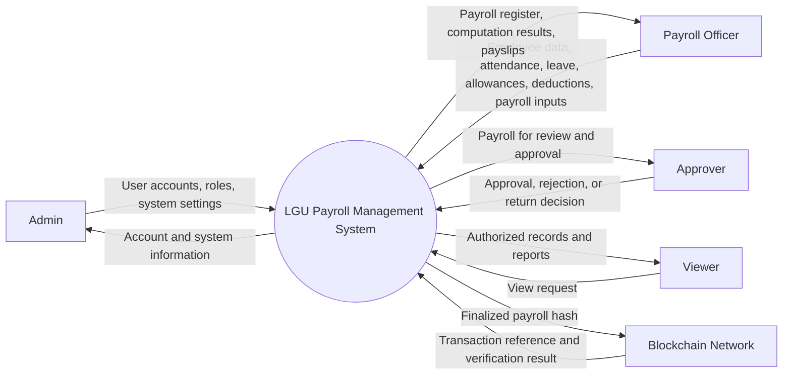
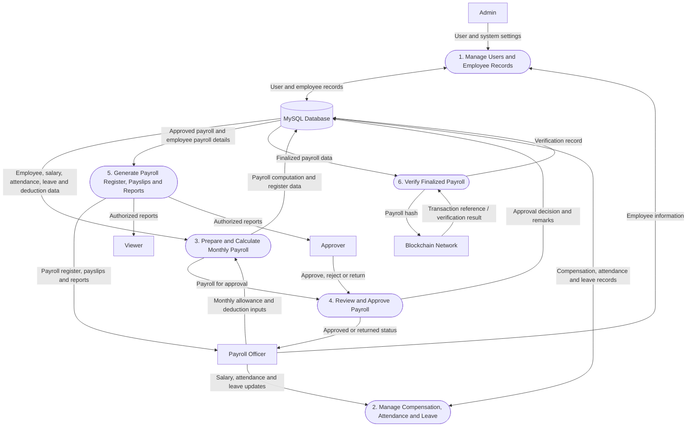
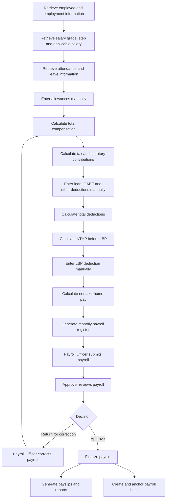

# LGU Payroll Management System – Simplified Data Flow Diagram

This simplified DFD is intended for capstone documentation and mock-defense presentation. It focuses on the four system roles, the main system processes, the MySQL database, and blockchain verification.

## 1. DFD Level 0 – Context Diagram

The whole LGU Payroll Management System is represented as one process. The external entities exchange information with the system.

## 2. DFD Level 1 – Main System Processes

This diagram shows the main processes and the central MySQL data store.

## 3. Simplified Monthly Payroll Process

This diagram focuses only on how a monthly payroll is prepared, approved, and finalized.

## 4. Main process descriptions

| No. | Process | Description |
|---:|---|---|
| 1 | Manage Users and Employee Records | Admin manages accounts and access; authorized staff maintain employee information. |
| 2 | Manage Compensation, Attendance and Leave | Maintains salary grade and step assignments, compensation profiles, day-based attendance, and leave information. |
| 3 | Prepare and Calculate Monthly Payroll | Retrieves employee and payroll data, accepts manual allowances and deductions, and calculates compensation and take-home pay. |
| 4 | Review and Approve Payroll | Approver independently reviews submitted payroll and approves, rejects, or returns it. |
| 5 | Generate Payroll Register, Payslips and Reports | Produces the monthly payroll register, employee payslips, and authorized reports. |
| 6 | Verify Finalized Payroll | Generates or checks a cryptographic hash and records blockchain transaction and verification information. |

## 5. Important business rules

1. Payroll is processed monthly.
2. The salary grade and step determine the monthly basic salary using the LGU-adopted salary schedule.
3. PERA, hazard pay, clothing, subsistence, laundry, and medical allowances are manually entered.
4. GABE deductions and loan deductions are manually entered by the Payroll Officer.
5. PhilHealth appears in the same monthly payroll register as the other deductions.
6. LBP is entered separately after calculating NTHP Before LBP; its exact meaning and arrangement should follow the client's confirmation.
7. The Payroll Officer who prepares and submits a payroll run cannot approve that same payroll run.
8. Only approved payroll can be finalized and proceed to payslip generation and blockchain anchoring.
9. Employee and payroll details remain in MySQL. Only the required cryptographic proof and transaction metadata are sent to the blockchain.

## 6. Short explanation for the mock defense

> The Data Flow Diagram illustrates how information moves through the LGU Payroll Management System. The Admin manages system access and employee records, while the Payroll Officer maintains payroll information and prepares the monthly payroll. The system retrieves compensation, attendance, and leave data, accepts manually entered allowances and deductions, and calculates the employee's total compensation and net take-home pay. The submitted payroll is independently reviewed by the Approver. Once approved and finalized, the system generates payslips and reports and may anchor a cryptographic hash to the blockchain for payroll integrity verification. The MySQL database stores the system's operational records.

## 7. Scope note

This is a simplified logical DFD for presentation. The detailed database design remains in the separate 39-table schema and ERD. Exact payroll rates, tax handling, contribution coverage, and the meaning of LBP should follow current official rules and the client's final instructions.
