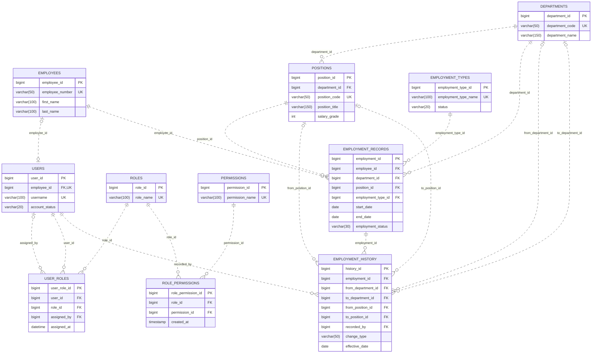
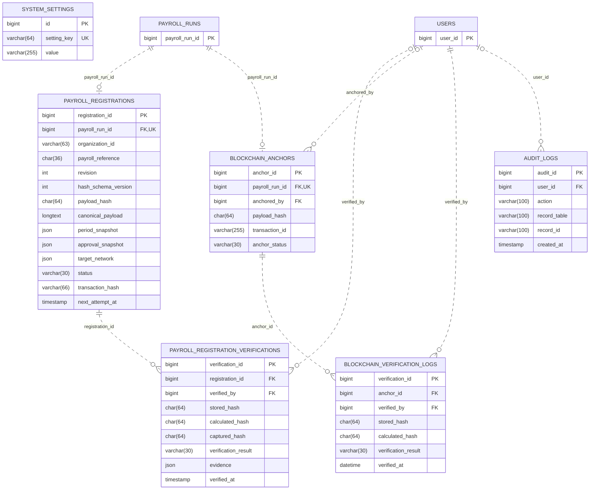

# LGU Payroll Management System - Entity Relationship Diagram

Verified on November 11, 2026 against the connected MySQL schema and applied migrations.

**36 application tables + 8 Laravel framework tables = 44 physical tables.** The diagrams below describe implemented relationships. See [Database Schema](database-schema.md) for every column, default, index and referential action.

## Reading the diagrams

- PK = primary key; FK = declared foreign key; UK = a single-column unique key.
- `||` = exactly one; `o|` = zero or one; `o{` = zero or many. A nullable child foreign key gives an optional parent.
- Child-side zero-or-one relationships come from a unique foreign-key column, such as a payroll run's registration or a payroll detail's payslip.
- Composite uniqueness is listed after the diagrams. Its member columns are not individually marked UK.
- Dotted relationship lines indicate non-identifying foreign keys; each child keeps its own primary key.
- Each domain diagram includes parent-table stubs where needed. A stub repeats an existing table; it is not another physical table. Non-key columns are selected for readability.
- Framework tables are shown separately. JSON references and application-level lookups are not drawn as SQL foreign keys.

## A. Access, organization and employment

User accounts, role assignments, departments, positions and employment records. Employment types are **Permanent**, **Coterminous** and **Elective**. Nullable account links permit system users without an employee record.



## B. Compensation, earnings, deductions and statutory configuration

Effective-dated salary schedules, compensation profiles and employee earning/deduction assignments. Positions store an optional grade number; grade compatibility is an application validation rule, not a foreign key.

```mermaid
erDiagram
    SALARY_SCHEDULES {
        bigint salary_schedule_id PK
        varchar(150) schedule_name
        date effective_from
        date effective_to
    }
    SALARY_GRADE_STEPS {
        bigint grade_step_id PK
        bigint salary_schedule_id FK
        int grade_number
        int step_number
        decimal(15,2) monthly_salary
    }
    COMPENSATION_PROFILES {
        bigint compensation_id PK
        bigint employment_id FK
        bigint grade_step_id FK
        varchar(30) pay_basis
        decimal(15,2) basic_rate
        decimal(5,4) service_fraction
        date effective_from
        date effective_to
    }
    EARNING_TYPES {
        bigint earning_type_id PK
        varchar(150) earning_name
        tinyint(1) is_taxable
    }
    EMPLOYEE_EARNING_ASSIGNMENTS {
        bigint assignment_id PK
        bigint employment_id FK
        bigint earning_type_id FK
        decimal(15,2) amount
        decimal(8,4) percentage
        date effective_from
        date effective_to
    }
    DEDUCTION_TYPES {
        bigint deduction_type_id PK
        varchar(150) deduction_name
        varchar(100) deduction_category
        tinyint(1) is_statutory
    }
    EMPLOYEE_DEDUCTION_ASSIGNMENTS {
        bigint assignment_id PK
        bigint employment_id FK
        bigint deduction_type_id FK
        decimal(15,2) amount
        decimal(8,4) percentage
        varchar(100) reference_number
        date effective_from
        date effective_to
    }
    TAX_BRACKETS {
        bigint tax_bracket_id PK
        decimal(15,2) minimum_income
        decimal(15,2) maximum_income
        decimal(15,2) base_tax
        decimal(8,4) marginal_tax_rate
        date effective_from
    }
    CONTRIBUTION_RATES {
        bigint contribution_rate_id PK
        varchar(100) contribution_type
        decimal(8,4) employee_rate
        decimal(8,4) employer_rate
        date effective_from
    }
    EMPLOYMENT_RECORDS {
        bigint employment_id PK
    }

    SALARY_SCHEDULES ||..o{ SALARY_GRADE_STEPS : salary_schedule_id
    EMPLOYMENT_RECORDS ||..o{ COMPENSATION_PROFILES : employment_id
    SALARY_GRADE_STEPS o|..o{ COMPENSATION_PROFILES : grade_step_id
    EARNING_TYPES ||..o{ EMPLOYEE_EARNING_ASSIGNMENTS : earning_type_id
    EMPLOYMENT_RECORDS ||..o{ EMPLOYEE_EARNING_ASSIGNMENTS : employment_id
    DEDUCTION_TYPES ||..o{ EMPLOYEE_DEDUCTION_ASSIGNMENTS : deduction_type_id
    EMPLOYMENT_RECORDS ||..o{ EMPLOYEE_DEDUCTION_ASSIGNMENTS : employment_id
```

## C. Payroll processing and outputs

Payroll runs preserve employee and compensation snapshots, approved manual inputs, itemized deductions, earnings and employer contributions. A payroll detail has at most one payslip. Deduction reports read the existing payroll deduction lines.

```mermaid
erDiagram
    PAYROLL_PERIODS {
        bigint payroll_period_id PK
        varchar(100) period_name
        date start_date
        date end_date
        date pay_date
        varchar(30) status
    }
    PAYROLL_RUNS {
        bigint payroll_run_id PK
        bigint payroll_period_id FK
        bigint created_by FK
        bigint submitted_by FK
        bigint finalized_by FK
        int run_number
        varchar(30) status
        datetime finalized_at
    }
    PAYROLL_APPROVALS {
        bigint approval_id PK
        bigint payroll_run_id FK
        bigint acted_by FK
        varchar(30) action
        datetime acted_at
    }
    PAYROLL_DETAILS {
        bigint payroll_detail_id PK
        bigint payroll_run_id FK
        bigint employee_id FK
        bigint employment_id FK
        bigint input_recorded_by FK
        varchar(50) employee_number_snapshot
        varchar(255) employee_name_snapshot
        int salary_grade_snapshot
        int salary_step_snapshot
        decimal(15,2) salary_rate_snapshot
        decimal(8,2) payable_days
        varchar(255) input_reference
        timestamp input_confirmed_at
        tinyint(1) manual_adjustments
        decimal(15,2) gross_pay
        decimal(15,2) total_deductions
        decimal(15,2) net_pay
    }
    PAYROLL_EARNINGS {
        bigint payroll_earning_id PK
        bigint payroll_detail_id FK
        bigint earning_type_id FK
        varchar(150) earning_name_snapshot
        decimal(15,2) amount
    }
    PAYROLL_DEDUCTIONS {
        bigint payroll_deduction_id PK
        bigint payroll_detail_id FK
        bigint deduction_type_id FK
        varchar(150) deduction_name_snapshot
        decimal(15,2) amount
    }
    PAYROLL_EMPLOYER_CONTRIBUTIONS {
        bigint employer_contribution_id PK
        bigint payroll_detail_id FK
        bigint contribution_rate_id FK
        varchar(100) contribution_type_snapshot
        decimal(15,2) amount
    }
    PAYROLL_ADJUSTMENTS {
        bigint adjustment_id PK
        bigint payroll_detail_id FK
        bigint requested_by FK
        bigint approved_by FK
        decimal(15,2) amount
        varchar(30) approval_status
    }
    PAYSLIPS {
        bigint payslip_id PK
        bigint payroll_detail_id FK,UK
        varchar(100) payslip_number UK
        varchar(30) publication_status
    }
    GENERATED_REPORTS {
        bigint report_id PK
        bigint generated_by FK
        varchar(100) report_type
        json filters
        varchar(500) file_path
        datetime generated_at
    }
    USERS {
        bigint user_id PK
    }
    EMPLOYEES {
        bigint employee_id PK
    }
    EMPLOYMENT_RECORDS {
        bigint employment_id PK
    }
    EARNING_TYPES {
        bigint earning_type_id PK
    }
    DEDUCTION_TYPES {
        bigint deduction_type_id PK
    }
    CONTRIBUTION_RATES {
        bigint contribution_rate_id PK
    }

    USERS ||..o{ PAYROLL_RUNS : created_by
    USERS o|..o{ PAYROLL_RUNS : finalized_by
    PAYROLL_PERIODS ||..o{ PAYROLL_RUNS : payroll_period_id
    USERS o|..o{ PAYROLL_RUNS : submitted_by
    USERS ||..o{ PAYROLL_APPROVALS : acted_by
    PAYROLL_RUNS ||..o{ PAYROLL_APPROVALS : payroll_run_id
    EMPLOYEES ||..o{ PAYROLL_DETAILS : employee_id
    EMPLOYMENT_RECORDS ||..o{ PAYROLL_DETAILS : employment_id
    USERS o|..o{ PAYROLL_DETAILS : input_recorded_by
    PAYROLL_RUNS ||..o{ PAYROLL_DETAILS : payroll_run_id
    EARNING_TYPES ||..o{ PAYROLL_EARNINGS : earning_type_id
    PAYROLL_DETAILS ||..o{ PAYROLL_EARNINGS : payroll_detail_id
    DEDUCTION_TYPES ||..o{ PAYROLL_DEDUCTIONS : deduction_type_id
    PAYROLL_DETAILS ||..o{ PAYROLL_DEDUCTIONS : payroll_detail_id
    CONTRIBUTION_RATES ||..o{ PAYROLL_EMPLOYER_CONTRIBUTIONS : contribution_rate_id
    PAYROLL_DETAILS ||..o{ PAYROLL_EMPLOYER_CONTRIBUTIONS : payroll_detail_id
    USERS o|..o{ PAYROLL_ADJUSTMENTS : approved_by
    PAYROLL_DETAILS ||..o{ PAYROLL_ADJUSTMENTS : payroll_detail_id
    USERS ||..o{ PAYROLL_ADJUSTMENTS : requested_by
    PAYROLL_DETAILS ||..o| PAYSLIPS : payroll_detail_id
    USERS ||..o{ GENERATED_REPORTS : generated_by
```

## D. Payroll Verification, auditing and settings

Versioned Payroll Verification registrations and append-only check history coexist with legacy anchors. Audit and settings records support the application. One registration per payroll run is enforced by a unique foreign key.



## E. Laravel framework infrastructure

Session, password-reset, cache, queue and migration infrastructure. These eight tables have no declared foreign keys in the inspected schema; sessions.user_id is an indexed application reference.

```mermaid
erDiagram
    SESSIONS {
        varchar(255) id PK
        bigint user_id
        varchar(45) ip_address
        text user_agent
        longtext payload
    }
    PASSWORD_RESET_TOKENS {
        varchar(255) email PK
        varchar(255) token
        timestamp created_at
    }
    CACHE {
        varchar(255) key PK
        mediumtext value
        bigint expiration
    }
    CACHE_LOCKS {
        varchar(255) key PK
        varchar(255) owner
        bigint expiration
    }
    JOBS {
        bigint id PK
        varchar(255) queue
        longtext payload
        smallint attempts
        int reserved_at
    }
    JOB_BATCHES {
        varchar(255) id PK
        varchar(255) name
        int total_jobs
        int pending_jobs
        int failed_jobs
    }
    FAILED_JOBS {
        bigint id PK
        varchar(255) uuid UK
        varchar(255) connection
        varchar(255) queue
        longtext payload
    }
    MIGRATIONS {
        int id PK
        varchar(255) migration
        int batch
    }

```



## Important unique constraints

| Table | Unique key |
|---|---|
| `blockchain_anchors` | `payroll_run_id` |
| `departments` | `department_code` |
| `employees` | `employee_number` |
| `employment_types` | `employment_type_name` |
| `failed_jobs` | `uuid` |
| `payroll_details` | `payroll_run_id` + `employment_id` |
| `payroll_periods` | `payroll_type` + `start_date` + `end_date` |
| `payroll_registrations` | `organization_id` + `payroll_reference` + `revision` |
| `payroll_registrations` | `idempotency_key` |
| `payroll_registrations` | `payroll_run_id` |
| `payroll_runs` | `payroll_period_id` + `run_number` |
| `payslips` | `payroll_detail_id` |
| `payslips` | `payslip_number` |
| `permissions` | `permission_name` |
| `positions` | `position_code` |
| `role_permissions` | `role_id` + `permission_id` |
| `roles` | `role_name` |
| `salary_grade_steps` | `salary_schedule_id` + `grade_number` + `step_number` |
| `system_settings` | `setting_key` |
| `user_roles` | `user_id` + `role_id` |
| `users` | `employee_id` |
| `users` | `username` |

## Current design notes

- The previous attendance and leave tables were removed: `attendance_records`, `attendance_adjustments`, `leave_types`, `leave_balances`, `leave_applications` and `leave_transactions`. Legacy creation migrations remain in source history; their presence does not mean the tables still exist.
- Approved manual payroll inputs are held in `payroll_details.payable_days`, `input_reference`, `input_recorded_by`, `input_confirmed_at` and `manual_adjustments`.
- `positions.salary_grade` must match the selected `salary_grade_steps.grade_number` when a grade-step compensation profile is used. `grade_step_id` is nullable for direct-rate arrangements.
- Compensation snapshots and itemized payroll lines preserve the registered payroll version. Changing a current compensation profile does not automatically rewrite a finalized payroll.
- Payroll preparation/submission and independent review are separate duties. Laravel enforces reviewer independence, approved-only finalization and finalized-payroll locks.
- `payroll_registrations.payroll_run_id` is unique: the current schema supports at most one registration row per run. The identity tuple includes organization, reference and revision; it does not itself enable a multi-revision workflow for the same run.
- Registration captures the payroll hash, canonical payload, period/approval snapshots and pinned network identity. Submission and reconciliation run asynchronously. Verification appends a separate record for every check.
- Legacy `blockchain_anchors` and versioned `payroll_registrations` have independent histories. Do not join legacy verification logs to versioned registrations.
- `generated_reports.filters` contains JSON report scope, not a declared FK. `audit_logs.record_table` and `record_id` identify different kinds of records without a fixed FK.
- Deduction reports group saved `payroll_deductions` by deduction type and employee within a run. Viewing or printing them creates no new entity.
- Besu stores hashes and limited registration metadata; confidential employee and payroll details stay in MySQL. The private Node SQLite transaction journal is outside this MySQL ERD.
- Delete behavior is documented for every FK in [Database Schema](database-schema.md). Audit and registration relationships may use different delete policies; an ERD association is not permission to delete records.

## Table count reconciliation

| Category | Count |
|---|---:|
| Access, organization and employment | 11 |
| Compensation, earnings, deductions and statutory configuration | 9 |
| Payroll processing and outputs | 10 |
| Payroll Verification, auditing and settings | 6 |
| Laravel framework infrastructure | 8 |
| **Total application tables** | **36** |
| **Total physical tables, including framework infrastructure** | **44** |

Sources: Laravel Boost schema inspection, applied `database/migrations`, employment-type seeder and payroll application services.
