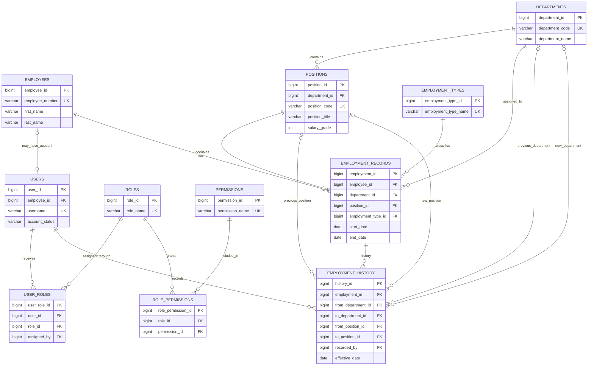
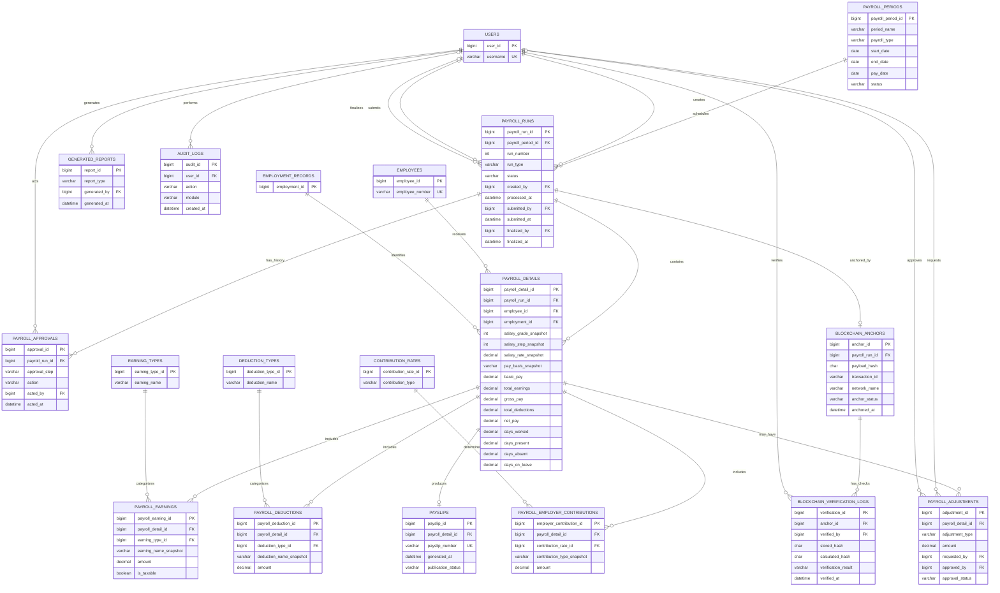
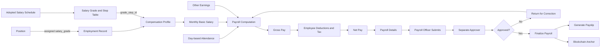

# LGU Payroll Management System – Updated Entity Relationship Diagram (ERD)

**Version:** Updated working design  
**Database:** MySQL  
**Total tables:** 39  
**Compensation update:** Position stores the assigned salary grade; the employee’s compensation profile points to the selected salary-grade/step row and retrieves its monthly salary from the applicable adopted schedule.

## 1. Confirmed design notes

- The four roles are **Admin, Payroll Officer, Approver, and Viewer**.
- Payroll preparation/submission and approval are separate duties. The user who creates or submits a payroll run must not approve that same run.
- Attendance is recorded in days, not hours.
- `positions.salary_grade` stores the grade assigned to the position. It may be NULL for a position that is not salary-grade based.
- `compensation_profiles.grade_step_id` references the salary schedule row for the employee’s grade and step.
- Laravel must validate that the selected `salary_grade_steps.grade_number` matches the employee’s `positions.salary_grade`, and that the selected schedule is effective for the payroll date.
- `salary_grade_steps.monthly_salary` is the monthly basic salary amount. Example: if the LGU-adopted schedule lists SG 15, Step 1 as ₱45,000, the employee’s monthly basic salary is ₱45,000 before applicable earnings and deductions.
- The actual salary schedule and amounts must come from the LGU’s adopted/approved schedule; illustrative values must not be treated as official amounts.

## 2. ERD A – User access, employees, organization, and employment

### Notes for ERD A

- `users.employee_id` is nullable and should be UNIQUE if the design allows at most one login account per employee. System accounts that are not linked to an employee may leave it NULL.
- `user_roles.assigned_by` is a second foreign key to `users.user_id` for the user who assigned the role.
- `employment_history.from_department_id`, `to_department_id`, `from_position_id`, and `to_position_id` each reference their respective master tables. The labels distinguish the two roles of each relationship.
- `positions.salary_grade` stores the grade number assigned to the position. It is not a separate salary amount.

## 3. ERD B – Compensation, attendance, leave, and deduction setup

```mermaid
erDiagram
    SALARY_SCHEDULES {
        bigint salary_schedule_id PK
        varchar schedule_name
        date effective_from
        date effective_to
    }
    SALARY_GRADE_STEPS {
        bigint grade_step_id PK
        bigint salary_schedule_id FK
        int grade_number
        int step_number
        decimal monthly_salary
    }
    COMPENSATION_PROFILES {
        bigint compensation_id PK
        bigint employment_id FK
        bigint grade_step_id FK
        varchar pay_basis
        decimal basic_rate
        decimal service_fraction
        date effective_from
        date effective_to
    }
    EARNING_TYPES {
        bigint earning_type_id PK
        varchar earning_name
        varchar computation_type
        boolean is_taxable
    }
    EMPLOYEE_EARNING_ASSIGNMENTS {
        bigint assignment_id PK
        bigint employment_id FK
        bigint earning_type_id FK
        decimal amount
        decimal percentage
        date effective_from
        date effective_to
    }
    ATTENDANCE_RECORDS {
        bigint attendance_id PK
        bigint employee_id FK
        date attendance_date
        varchar attendance_status
        decimal credited_days
    }
    ATTENDANCE_ADJUSTMENTS {
        bigint adjustment_id PK
        bigint attendance_id FK
        bigint requested_by FK
        bigint reviewed_by FK
        varchar old_attendance_status
        varchar requested_attendance_status
        decimal old_credited_days
        decimal requested_credited_days
    }
    LEAVE_TYPES {
        bigint leave_type_id PK
        varchar leave_name
        decimal default_credit
        boolean is_paid
    }
    LEAVE_BALANCES {
        bigint leave_balance_id PK
        bigint employee_id FK
        bigint leave_type_id FK
        int leave_year
        decimal available_balance
    }
    LEAVE_APPLICATIONS {
        bigint leave_application_id PK
        bigint employee_id FK
        bigint leave_type_id FK
        date start_date
        date end_date
        decimal total_days
        varchar approval_status
        bigint approved_by FK
    }
    LEAVE_TRANSACTIONS {
        bigint leave_transaction_id PK
        bigint leave_balance_id FK
        bigint leave_application_id FK
        decimal days
        decimal balance_after
        bigint created_by FK
    }
    DEDUCTION_TYPES {
        bigint deduction_type_id PK
        varchar deduction_name
        varchar computation_type
        boolean is_statutory
    }
    EMPLOYEE_DEDUCTION_ASSIGNMENTS {
        bigint assignment_id PK
        bigint employment_id FK
        bigint deduction_type_id FK
        decimal amount
        decimal percentage
        date effective_from
        date effective_to
    }
    TAX_BRACKETS {
        bigint tax_bracket_id PK
        varchar tax_type
        varchar pay_frequency
        decimal minimum_income
        decimal maximum_income
        decimal base_tax
        decimal marginal_tax_rate
        date effective_from
        date effective_to
    }
    CONTRIBUTION_RATES {
        bigint contribution_rate_id PK
        varchar contribution_type
        decimal minimum_compensation
        decimal maximum_compensation
        decimal employee_rate
        decimal employer_rate
        date effective_from
        date effective_to
    }

    SALARY_SCHEDULES ||--o{ SALARY_GRADE_STEPS : contains
    EMPLOYMENT_RECORDS ||--o{ COMPENSATION_PROFILES : has
    SALARY_GRADE_STEPS o|--o{ COMPENSATION_PROFILES : selected_grade_step
    EMPLOYMENT_RECORDS ||--o{ EMPLOYEE_EARNING_ASSIGNMENTS : assigned
    EARNING_TYPES ||--o{ EMPLOYEE_EARNING_ASSIGNMENTS : defines
    EMPLOYEES ||--o{ ATTENDANCE_RECORDS : has
    ATTENDANCE_RECORDS ||--o{ ATTENDANCE_ADJUSTMENTS : may_be_corrected
    USERS ||--o{ ATTENDANCE_ADJUSTMENTS : requests
    USERS o|--o{ ATTENDANCE_ADJUSTMENTS : reviews
    EMPLOYEES ||--o{ LEAVE_BALANCES : has
    LEAVE_TYPES ||--o{ LEAVE_BALANCES : classifies
    EMPLOYEES ||--o{ LEAVE_APPLICATIONS : files
    LEAVE_TYPES ||--o{ LEAVE_APPLICATIONS : categorizes
    USERS o|--o{ LEAVE_APPLICATIONS : approves
    LEAVE_BALANCES ||--o{ LEAVE_TRANSACTIONS : records
    LEAVE_APPLICATIONS o|--o{ LEAVE_TRANSACTIONS : may_generate
    USERS ||--o{ LEAVE_TRANSACTIONS : creates
    EMPLOYMENT_RECORDS ||--o{ EMPLOYEE_DEDUCTION_ASSIGNMENTS : assigned
    DEDUCTION_TYPES ||--o{ EMPLOYEE_DEDUCTION_ASSIGNMENTS : defines
```

### Notes for ERD B

- `salary_schedules` and `salary_grade_steps` hold the adopted salary rates. `salary_grade_steps` has a UNIQUE constraint on (`salary_schedule_id`, `grade_number`, `step_number`).
- `positions.salary_grade` must match `salary_grade_steps.grade_number` selected through `compensation_profiles.grade_step_id`. Because the grade is stored as an integer on `positions`, validate this match in Laravel (or add a separate salary-grade master table in a future schema revision if a strict FK is desired).
- For grade-and-step appointments, `compensation_profiles.grade_step_id` references the applicable salary row and `basic_rate` is NULL; retrieve the monthly salary from `salary_grade_steps.monthly_salary`.
- For a direct-rate arrangement, `grade_step_id` is NULL and `basic_rate` contains the authorized rate. `pay_basis` indicates how it is applied. `service_fraction` is used only for an approved proportional appointment.
- `tax_brackets` is a configuration table used by payroll computation according to effective date and pay frequency. It does not need a direct employee FK.
- `contribution_rates` is a configuration table; it connects to payroll employer contribution records in ERD C.
- Attendance is day-based: `attendance_records` contains no time-in, time-out, total-hours, or overtime-hours fields.
- Suggested attendance statuses and credited-day values must be configured according to the client’s actual policy. Do not automatically assume that holidays, leave, rest days, or absences have a universal credit value.

## 4. ERD C – Payroll, approval, payslips, audit, and blockchain

### Notes for ERD C

- `payroll_runs.created_by` identifies the user who created/prepared the run; `submitted_by` identifies the user who submitted it. In the expected workflow these are Payroll Officer actions.
- `payroll_approvals.acted_by` identifies the user who performed a review, approval, rejection, or return action. Approval/rejection must be performed by a separate user assigned the Approver role and required permission.
- For `APPROVED` actions, `acted_by` must not equal the run’s `created_by` or `submitted_by`. Enforce this in Laravel authorization/business logic.
- Only an approved run may transition to `FINALIZED`. Record finalization in `payroll_runs.finalized_by` and `finalized_at` and in the audit log.
- `payroll_approvals` is an action history table; do not overwrite earlier return/rejection records when a payroll run is corrected and resubmitted.
- One `blockchain_anchors` record per payroll run is supported by the UNIQUE `payroll_run_id` constraint. Each anchor may have multiple verification logs.
- `payroll_details` stores a payroll snapshot, including salary grade, step, rate, and pay basis. This preserves what was used when the payroll was processed.
- `payroll_employer_contributions` stores employer-side amounts separately; these are not deductions from employee net pay.

## 5. Simplified end-to-end salary and payroll relationship

## 6. Relationship and uniqueness checklist

| Table | Recommended constraint |
|---|---|
| `users` | UNIQUE `username`; UNIQUE nullable `employee_id` if one employee may have at most one account |
| `user_roles` | UNIQUE (`user_id`, `role_id`) |
| `role_permissions` | UNIQUE (`role_id`, `permission_id`) |
| `employees` | UNIQUE `employee_number` |
| `departments` | UNIQUE `department_code` |
| `positions` | UNIQUE `position_code`; index (`department_id`, `salary_grade`) |
| `salary_grade_steps` | UNIQUE (`salary_schedule_id`, `grade_number`, `step_number`) |
| `attendance_records` | UNIQUE (`employee_id`, `attendance_date`) if one record per employee per day |
| `leave_balances` | UNIQUE (`employee_id`, `leave_type_id`, `leave_year`) |
| `payroll_runs` | UNIQUE (`payroll_period_id`, `run_number`) |
| `payroll_details` | UNIQUE (`payroll_run_id`, `employment_id`) |
| `payslips` | UNIQUE `payroll_detail_id` and `payslip_number` |
| `blockchain_anchors` | UNIQUE `payroll_run_id` |

## 7. Table inventory (39 tables)

1. `users`
2. `roles`
3. `permissions`
4. `user_roles`
5. `role_permissions`
6. `employees`
7. `departments`
8. `positions`
9. `employment_types`
10. `employment_records`
11. `employment_history`
12. `salary_schedules`
13. `salary_grade_steps`
14. `compensation_profiles`
15. `earning_types`
16. `employee_earning_assignments`
17. `attendance_records`
18. `attendance_adjustments`
19. `leave_types`
20. `leave_balances`
21. `leave_applications`
22. `leave_transactions`
23. `deduction_types`
24. `employee_deduction_assignments`
25. `tax_brackets`
26. `contribution_rates`
27. `payroll_periods`
28. `payroll_runs`
29. `payroll_approvals`
30. `payroll_details`
31. `payroll_earnings`
32. `payroll_deductions`
33. `payroll_employer_contributions`
34. `payroll_adjustments`
35. `payslips`
36. `generated_reports`
37. `audit_logs`
38. `blockchain_anchors`
39. `blockchain_verification_logs`

## 8. Implementation note

This ERD is the updated proposed design for mock-defense preparation. Confirm the LGU-adopted salary schedule, appointment categories, payroll formulas, attendance treatment, deduction rules, and approval process with the Municipal Accounting Office before production use. The salary grade and step determine the monthly basic salary only when the selected schedule row is the one adopted by the LGU; gross pay adds applicable earnings, and net pay subtracts applicable employee deductions.
