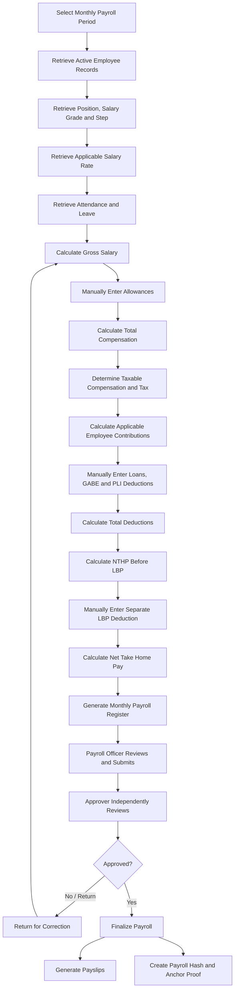

# Initial Payroll Computation Design
## LGU Payroll Management System

**Version:** Updated working design for mock defense  
**Payroll frequency:** Monthly  
**Primary basis:** Client-provided payroll register (`Payrolll.xlsx`) and client-verified process clarifications  
**Status:** Initial design; subject to final validation of statutory rates, tax treatment, and LGU accounting procedures

---

## 1. Purpose and scope

This document describes the proposed monthly payroll computation process for the LGU Payroll Management System. It follows the structure of the payroll register provided by the client and incorporates the client's clarifications.

The system is intended to calculate and record:

1. Employee basic salary;
2. Manually entered allowances and other earnings;
3. Total compensation;
4. Applicable employee statutory contributions;
5. Withholding tax;
6. Manually entered loan, GABE, and other deductions;
7. Total deductions;
8. Net take-home pay before the separate LBP deduction; and
9. Final net take-home pay after the separate LBP deduction.

The Payroll Officer prepares and submits the monthly payroll. A different user with the Approver role reviews and approves or returns it. A user must not approve a payroll run that the same user prepared or submitted.

## 2. Client-verified requirements

The following requirements were confirmed by the client:

| Item | Confirmed process |
|---|---|
| Payroll frequency | Monthly |
| Permanent employees | Basic monthly salary is determined by the applicable salary grade and step in the LGU-adopted salary schedule. |
| Coterminous employees | Basic compensation is retrieved from the applicable compensation schedule and appointment. |
| Part-time personnel | Use the compensation basis authorized in the appointment, such as an approved daily rate or proportionate monthly rate. |
| PERA | Manually entered by the Payroll Officer. |
| Hazard Pay | Manually entered by the Payroll Officer. |
| Clothing Allowance | Manually entered by the Payroll Officer. |
| Subsistence Allowance | Manually entered by the Payroll Officer. |
| Laundry Allowance | Manually entered by the Payroll Officer. |
| Medical Allowance | Manually entered by the Payroll Officer. |
| GABE – Salamat Mabuhay | Manually entered by the Payroll Officer. |
| GABE – Fines | Manually entered by the Payroll Officer. |
| Loan deductions and other PLI deductions | Manually entered for the applicable monthly payroll. No lender integration or automated amortization schedule is required for the initial version. |
| PhilHealth | Must appear in the same payroll register as the other contributions and deductions. |
| LBP Loan Deduction | Remains a separate manually entered amount after NTHP Before LBP. The exact meaning and arrangement represented by “LBP” should still be confirmed. |
| Total Compensation | Automatically calculated. |
| Total Deductions | Automatically calculated. |
| NTHP Before LBP | Automatically calculated. |
| Net Take Home Pay | Automatically calculated after the LBP deduction. |

### 2.1 Manual loan entry

For the initial system, the Payroll Officer enters the loan or dues deduction amount for each employee in the applicable monthly payroll. The system records the entered amount against the employee, payroll run, and deduction type. The system does not need to connect to GSIS, Pag-IBIG, LANDBANK, or other lending institutions to retrieve amortization schedules.

Manual entry should still be traceable. Record the user who entered or changed the amount, the date and time, the payroll run, the deduction category, and any reference or remarks supplied by the Accounting Office.

## 3. Employee information and compensation retrieval

Before computing payroll, the system retrieves the employee's:

- Office or department;
- Employee number;
- Full name;
- Position;
- Employment classification;
- Salary grade, where applicable;
- Salary step, where applicable; and
- Applicable compensation rate.

### 3.1 Salary grade and step

The salary grade identifies the compensation level assigned to the position. The salary step identifies the employee's position within that grade. The actual monthly basic salary is the peso amount in the applicable salary schedule for the selected grade and step.

**Illustrative example supplied by the client:** SG 15, Step 1 = ₱45,000.00 monthly basic salary. This is an example only. The production system must use the actual salary amount in the LGU's adopted and authorized salary schedule, including its effective date and applicable LGU schedule.

The intended lookup is:

```text
Position → Salary Grade
Employment/Compensation Profile → Salary Step and Schedule
Salary Schedule + Grade + Step → Monthly Basic Salary
```

The system should not ask the Payroll Officer to retype the basic salary every payroll period when it can be retrieved from the employee's effective compensation profile.

### 3.2 Monthly-paid employees

For a complete month of paid service:

```text
Gross Salary = Applicable Monthly Basic Salary
```

Where leave without pay applies, CSC Memorandum Circular No. 08, s. 2014 prescribes the following computation:

\[
\text{Salary} = \frac{\text{Days in Paid Status}}{22} \times \text{Monthly Salary}
\]

where:

\[
\text{Days in Paid Status} = 22 - \text{Days Without Pay}
\]

This formula is for leave without pay. Approved paid leave must not automatically be treated as unpaid absence. The applicable CSC rules and LGU attendance/leave procedures must be followed.

**Example:** Monthly salary = ₱45,000.00; leave without pay = 2 days.

\[
\frac{22-2}{22}\times ₱45,000 = ₱40,909.09
\]

This is an illustration of the CSC leave-without-pay formula, not a general rule for every attendance status.

### 3.3 Part-time personnel

Use the compensation method stated in the employee's appointment or approved compensation arrangement.

For an authorized daily-rate appointment:

\[
\text{Basic Pay} = \text{Approved Daily Rate} \times \text{Credited Paid Days}
\]

For an appointment with proportionate monthly compensation, use the authorized monthly rate or service fraction. Do not automatically apply the daily-rate formula to every part-time employee.

## 4. Earnings and total compensation

The client confirmed that the following allowance amounts will be manually entered by the Payroll Officer for the monthly payroll:

| Payroll register field | Entry method |
|---|---|
| Gross Salary | Retrieved/computed from compensation and applicable attendance rules |
| PERA | Manual input |
| Hazard Pay | Manual input |
| Clothing Allow | Manual input |
| Subsistence Allow | Manual input |
| Laundry Allow | Manual input |
| Medical Allow | Manual input |
| Total Compensation | Automatic calculation |

The system should provide input validation and retain the user and timestamp for each manual entry. The tax treatment of each allowance must be classified according to applicable BIR rules; manual entry does not mean that every allowance is automatically taxable or tax-exempt.

### 4.1 Total Compensation formula

Following the client register:

\[
\begin{aligned}
\text{Total Compensation} ={}& \text{Gross Salary} + \text{PERA} + \text{Hazard Pay} \\
&+ \text{Clothing Allow} + \text{Subsistence Allow} \\
&+ \text{Laundry Allow} + \text{Medical Allow}
\end{aligned}
\]

Excel-style formula for the first employee row in the updated register:

```excel
=SUM(F4:L4)
```

The resulting amount is stored as the payroll run's total compensation for that employee.

## 5. Statutory employee contributions

The system should calculate applicable statutory contributions using effective-dated configuration and the employee's coverage. The employee share is a payroll deduction. The employer share is recorded separately and must not reduce the employee's net pay.

### 5.1 GSIS

For regular members covered by the GSIS contribution rules, the GSIS website states a member contribution rate of 9% and government agency contribution rate of 12%, based on the member's actual monthly salary. Coverage and exceptions must be checked for the employee's appointment and membership status.

```text
Employee GSIS Share = Applicable GSIS Salary Base × 9%
Employer GSIS Share = Applicable GSIS Salary Base × 12%
```

The employee share appears under `GSIS Contrib.` in the payroll register. The government share is stored separately as an employer contribution.

### 5.2 PhilHealth

The client requires PhilHealth to appear in the same monthly payroll register. Add a dedicated `PhilHealth Contrib.` column in the updated register.

The system should determine the contribution using the latest PhilHealth Premium Contribution Table and the member's applicable monthly basic salary/contribution base. The employee and employer shares must be recorded separately. Keep the applicable rate, floor, ceiling, and effective dates configurable; verify the latest official table before production deployment.

```text
Total PhilHealth Premium = Applicable Contribution Base × Current Premium Rate
Employee Share = Total Premium × Employee Share Percentage
Employer Share = Total Premium × Employer Share Percentage
```

Do not hard-code an obsolete contribution table. Use the latest official PhilHealth instructions and confirm coverage for each employment classification.

### 5.3 Pag-IBIG / HDMF

Pag-IBIG Fund Circular No. 460 increased the maximum fund salary used to calculate Pag-IBIG I membership savings to ₱10,000 effective February 2024. The stated rates are 1% employee / 2% employer for fund salary of ₱1,500 and below, and 2% employee / 2% employer for fund salary above ₱1,500, subject to the applicable rules.

```text
Pag-IBIG Contribution Base = MIN(Applicable Fund Salary, ₱10,000)
Employee Share = Contribution Base × Applicable Employee Rate
Employer Share = Contribution Base × Applicable Employer Rate
```

The employee share appears under `Pag ibig Contrib.`. The employer share is recorded separately. Confirm the applicable coverage and rules before production use.

## 6. Withholding tax – annual graduated income tax method

### 6.1 Proposed initial method

For the initial prototype and mock-defense computation, the client/team's proposed approach is to:

1. Project the employee's annual taxable compensation;
2. Determine applicable non-taxable/exempt compensation and mandatory employee contributions under BIR rules;
3. Apply the annual graduated income tax table;
4. Divide the resulting annual income tax by 12 to calculate the proposed monthly tax projection; and
5. Place the monthly amount in `Personal Income Tax-Withholding` in the payroll register.

\[
\text{Monthly Tax Projection} = \frac{\text{Annual Income Tax}}{12}
\]

### 6.2 Annual graduated income tax table

The following graduated rates apply to individual taxable income under the TRAIN tax schedule for taxable years beginning 2023 onward:

| Annual taxable income | Tax due |
|---|---|
| Not over ₱250,000 | 0% |
| Over ₱250,000 but not over ₱400,000 | 15% of excess over ₱250,000 |
| Over ₱400,000 but not over ₱800,000 | ₱22,500 + 20% of excess over ₱400,000 |
| Over ₱800,000 but not over ₱2,000,000 | ₱102,500 + 25% of excess over ₱800,000 |
| Over ₱2,000,000 but not over ₱8,000,000 | ₱402,500 + 30% of excess over ₱2,000,000 |
| Over ₱8,000,000 | ₱2,202,500 + 35% of excess over ₱8,000,000 |

The tax base must be determined under BIR rules. In particular, the taxable treatment of each allowance and benefit must be classified correctly. Employee mandatory contributions may be taken into account as prescribed. Ordinary loan repayments, GABE deductions, fines, and private lending institution deductions must not automatically be treated as deductions from taxable income.

### 6.3 Compliance distinction

BIR Revenue Regulations No. 11-2018 generally requires employers to withhold using the prescribed periodic withholding tax table in Annex E for monthly, semi-monthly, weekly, or daily compensation. The regulations also provide an annualized computation for the appropriate annual/year-end or termination adjustment.

Therefore, `Annual Income Tax ÷ 12` is documented here as the **proposed monthly projection method for the initial prototype**, not as a statement that it replaces the BIR-prescribed monthly withholding process. Before live payroll deployment, the system should support the BIR Annex E periodic withholding method and year-end/termination annual reconciliation, as confirmed by the Municipal Accounting Office.

## 7. Manual loan, GABE, and other deductions

The client confirmed that loan and other non-statutory deduction amounts will be manually entered by the Payroll Officer for each monthly payroll. The initial system does not require an automated amortization schedule or integration with lenders.

### 7.1 GSIS-related deduction fields

| Register field | Entry method |
|---|---|
| EMER. | Manual input |
| CONSO. | Manual input |
| POLICY | Manual input |
| GFAL | Manual input |
| MPL | Manual input |
| COMPUTER | Manual input |
| MPL LITE | Manual input |
| GSL | Manual input |

The `GSIS Contrib.` employee share is calculated separately. These loan or other deduction labels retain the names in the client's register; exact descriptions and supporting rules should be confirmed by the Accounting Office.

### 7.2 Pag-IBIG-related deduction fields

| Register field | Entry method |
|---|---|
| CALAMITY | Manual input |
| MPL | Manual input |
| HOUSING | Manual input |
| MP2 | Manual input |

`Pag ibig Contrib.` is calculated separately. MP2 is voluntary savings and should be recorded as a separately authorized deduction rather than treated as the mandatory Pag-IBIG contribution.

### 7.3 GABE fields

| Register field | Entry method |
|---|---|
| SALAMAT MABUHAY | Manual input |
| FINES | Manual input |

The system should preserve the client's labels. The full meaning of GABE, the authority for each deduction, and any applicable limits should be obtained from the client rather than assumed.

### 7.4 Other PLI / dues fields

| Register field | Entry method |
|---|---|
| SEPT. 2026 DUES | Manual input; label should be configurable by payroll period |
| CITY SAVINGS | Manual input |
| FCB | Manual input |
| Cebu CFI | Manual input |
| BDO | Manual input |

Each entered amount is stored as a payroll deduction associated with the employee, payroll run, and deduction type.

### 7.5 LBP Loan Deduction

The client's register deducts the LBP amount **after** calculating NTHP Before LBP. The initial design therefore retains it as a separate manually entered field. Keep the label `LBP Loan Deduction` until the client confirms its exact meaning and arrangement; do not assume details beyond the client's register.

## 8. Total deductions and net take-home pay

### 8.1 Total Deductions

Total Deductions include the withholding tax, employee statutory contributions, and all manually entered deduction fields included before the LBP deduction.

\[
\begin{aligned}
\text{Total Deductions} ={}& \text{Withholding Tax} + \text{GSIS Contribution} \\
&+ \text{GSIS Loan/Other Deductions} + \text{PhilHealth Contribution} \\
&+ \text{Pag-IBIG Contribution} + \text{Pag-IBIG Loan/MP2 Deductions} \\
&+ \text{GABE Deductions} + \text{Other PLI/Dues Deductions}
\end{aligned}
\]

### 8.2 NTHP Before LBP

\[
\boxed{\text{NTHP Before LBP} = \text{Total Compensation} - \text{Total Deductions}}
\]

### 8.3 Net Take Home Pay

\[
\boxed{\text{Net Take Home Pay} = \text{NTHP Before LBP} - \text{LBP Loan Deduction}}
\]

The LBP amount must not be counted twice. It is not included in Total Deductions if it is deducted separately after NTHP Before LBP.

## 9. Updated monthly payroll register column layout

The uploaded workbook has a `Payroll` sheet with the employee register headers in row 3. It currently has no PhilHealth column. Because the client confirmed that PhilHealth must appear in the same register, insert `PhilHealth Contrib.` after the GSIS loan/deduction fields and before `Pag ibig Contrib.`. This shifts the later register columns by one position.

| Updated column | Register field | Method |
|---|---|---|
| B | Office | Retrieved |
| C | Employee Number | Retrieved |
| D | Name | Retrieved |
| E | Position | Retrieved |
| F | Gross Salary | Retrieved/computed |
| G | PERA | Manual |
| H | Hazard Pay | Manual |
| I | Clothing Allow | Manual |
| J | Subsistence Allow | Manual |
| K | Laundry allow | Manual |
| L | Medical Allow | Manual |
| M | Total Compensation | Automatic |
| N | Personal Income Tax-Withholding | Automatic/proposed projection; BIR rules apply |
| O | GSIS Contrib | Automatic, subject to coverage |
| P | EMER. | Manual |
| Q | CONSO. | Manual |
| R | POLICY | Manual |
| S | GFAL | Manual |
| T | MPL | Manual |
| U | COMPUTER | Manual |
| V | MPL LITE | Manual |
| W | GSL | Manual |
| X | PhilHealth Contrib. | Automatic, subject to coverage and current table |
| Y | Pag ibig Contrib. | Automatic, subject to coverage |
| Z | CALAMITY | Manual |
| AA | MPL | Manual |
| AB | HOUSING | Manual |
| AC | MP2 | Manual |
| AD | SALAMAT MABUHAY | Manual |
| AE | FINES | Manual |
| AF | SEPT. 2026 DUES | Manual; configurable label |
| AG | CITY SAVINGS | Manual |
| AH | FCB | Manual |
| AI | Cebu CFI | Manual |
| AJ | BDO | Manual |
| AK | TOTAL DEDUCTIONS | Automatic |
| AL | NTHP Before LBP | Automatic |
| AM | LBP Loan Deduction | Manual; separate |
| AN | Net Take Home Pay | Automatic |

### 9.1 Suggested spreadsheet formulas

Assuming the first employee record is row 4:

| Field | Formula |
|---|---|
| Total Compensation (M4) | `=SUM(F4:L4)` |
| Total Deductions (AK4) | `=SUM(N4:AJ4)` |
| NTHP Before LBP (AL4) | `=M4-AK4` |
| Net Take Home Pay (AN4) | `=AL4-AM4` |

Copy the formulas down for all employee rows. The grand-total row should sum every monetary column that is intended to be totaled. Do not add employee identifiers or text fields.

## 10. Illustrative sample computation

The following is an example for demonstrating the computation sequence. It is not an actual employee record or a confirmed LGU payroll result.

**Assumptions:**

- Monthly basic salary: ₱45,000.00 (client's illustrative SG 15, Step 1 example; actual rate must be from the adopted schedule).
- Complete month of paid service.
- No additional allowances for this example.
- Covered by GSIS, PhilHealth, and Pag-IBIG.
- Illustrative PhilHealth rate/share uses 5% total premium split equally; verify the latest official table before deployment.
- No loans, GABE, PLI, MP2, or LBP deductions.
- Compensation is stable for 12 months and there are no other taxable benefits or year-end adjustments.

### 10.1 Earnings

| Description | Amount |
|---|---:|
| Gross Salary | ₱45,000.00 |
| PERA | ₱0.00 |
| Hazard Pay | ₱0.00 |
| Clothing Allow | ₱0.00 |
| Subsistence Allow | ₱0.00 |
| Laundry Allow | ₱0.00 |
| Medical Allow | ₱0.00 |
| **Total Compensation** | **₱45,000.00** |

### 10.2 Employee statutory contributions (illustrative rates)

| Deduction | Computation | Amount |
|---|---|---:|
| GSIS employee share | ₱45,000 × 9% | ₱4,050.00 |
| PhilHealth employee share | ₱45,000 × 2.5% | ₱1,125.00 |
| Pag-IBIG employee share | ₱10,000 × 2% | ₱200.00 |
| **Total employee contributions** | | **₱5,375.00** |

### 10.3 Annual tax projection

Annual basic compensation:

\[
₱45,000 \times 12 = ₱540,000
\]

Annual mandatory employee contributions under the example assumptions:

\[
₱5,375 \times 12 = ₱64,500
\]

Simplified annual taxable regular compensation for this example:

\[
₱540,000 - ₱64,500 = ₱475,500
\]

Annual tax using the ₱400,000–₱800,000 bracket:

\[
₱22,500 + (₱475,500 - ₱400,000) \times 20\% = ₱37,600
\]

Proposed monthly projection:

\[
₱37,600 \div 12 = ₱3,133.33
\]

This example is simplified. Production withholding must use the applicable BIR periodic table and required annualized reconciliation, with proper treatment of all taxable and non-taxable earnings.

### 10.4 Example net pay

| Description | Amount |
|---|---:|
| Total Compensation | ₱45,000.00 |
| GSIS employee share | ₱4,050.00 |
| PhilHealth employee share | ₱1,125.00 |
| Pag-IBIG employee share | ₱200.00 |
| Proposed monthly tax projection | ₱3,133.33 |
| Other deductions | ₱0.00 |
| **Total Deductions** | **₱8,508.33** |
| **NTHP Before LBP** | **₱36,491.67** |
| LBP Loan Deduction | ₱0.00 |
| **Net Take Home Pay** | **₱36,491.67** |

### 10.5 Employer-side contributions

Employer contributions are tracked separately and are not deducted from the employee's net pay.

| Contribution | Example computation | Amount |
|---|---|---:|
| GSIS government share | ₱45,000 × 12% | ₱5,400.00 |
| PhilHealth employer share | ₱45,000 × 2.5% | ₱1,125.00 |
| Pag-IBIG employer share | ₱10,000 × 2% | ₱200.00 |
| **Total employer contributions** | | **₱6,725.00** |

The rates and contribution bases in this illustration must be checked against current rules and the employee's coverage at the time of payroll.

## 11. Payroll processing and approval workflow



### Separation-of-duties rules

1. The Payroll Officer prepares and submits payroll.
2. The Approver independently reviews, approves, rejects, or returns payroll.
3. A user who prepared or submitted a payroll run must not approve the same run.
4. Only an approved payroll run can be finalized.
5. Submission, review, approval, rejection, return, and finalization actions are recorded in the approval history and audit trail.
6. Admin privileges must not silently bypass the approval workflow.

## 12. Database implementation mapping

The initial calculation can be implemented using the existing 39-table database design. No new table is required solely for manual allowances or loan inputs.

| Payroll function | Existing tables |
|---|---|
| Employee information | `employees` |
| Office and position | `departments`, `positions` |
| Employment classification | `employment_types`, `employment_records` |
| Salary schedule and step | `salary_schedules`, `salary_grade_steps` |
| Employee compensation | `compensation_profiles` |
| Attendance and leave | `attendance_records`, `leave_applications`, `leave_transactions`, `leave_balances` |
| Allowance definitions and entries | `earning_types`, `employee_earning_assignments`, `payroll_earnings` |
| Tax configuration | `tax_brackets` |
| Contribution configuration | `contribution_rates` |
| Manual deduction definitions and entries | `deduction_types`, `employee_deduction_assignments`, `payroll_deductions` |
| Payroll summary | `payroll_runs`, `payroll_details` |
| Employer contributions | `payroll_employer_contributions` |
| Approval | `payroll_approvals` |
| Payslip output | `payslips` |
| Reports | `generated_reports` |
| Audit trail | `audit_logs` |
| Blockchain proof | `blockchain_anchors`, `blockchain_verification_logs` |

### 12.1 Recommended payroll detail fields

To preserve the client's register totals, ensure `payroll_details` contains:

| Column | Data type | Purpose |
|---|---|---|
| total_earnings | DECIMAL(15,2) | Sum of applicable additional earnings |
| gross_pay | DECIMAL(15,2) | Total compensation for the payroll calculation |
| total_deductions | DECIMAL(15,2) | Total deductions before the separate LBP line |
| nthp_before_lbp | DECIMAL(15,2) | Total compensation less total deductions |
| lbp_loan_deduction | DECIMAL(15,2) | Separately entered LBP amount |
| net_pay | DECIMAL(15,2) | NTHP Before LBP less LBP deduction |

Use a consistent definition for `gross_pay` and `total_compensation` throughout reports and payslips. In the client register, the displayed `Total Compensation` is the amount used as the starting point for NTHP Before LBP.

## 13. Controls and audit requirements

- Validate that manual allowance and deduction inputs are numeric, non-negative unless an approved correction process permits a reversal, and associated with an employee and payroll run.
- Record the user, timestamp, payroll run, earning/deduction type, amount, and optional reference/remarks for manual inputs.
- Do not include employer contributions in employee deductions.
- Do not include LBP in Total Deductions if it is subtracted separately after NTHP Before LBP.
- Preserve finalized payroll results as historical records. Corrections must use an authorized adjustment process.
- Apply current rates and effective dates rather than hard-coding government contribution or tax parameters into application code.
- Use decimal arithmetic for monetary calculations and define the rounding rule consistently.
- Restrict approval to an authorized Approver who is not the preparer/submitter of the same payroll run.

## 14. Items still requiring confirmation before live payroll

The client has verified the manual-entry and monthly-register requirements described in Section 2. The following items still need final confirmation or official configuration before production deployment:

1. The exact meaning and arrangement represented by `LBP` in the register.
2. The full meaning of `GABE`, and the authority or policy for each GABE deduction.
3. Whether the label `SEPT. 2026 DUES` should be replaced by a period-neutral field such as `Monthly Dues` or updated each month.
4. The LGU's formally adopted salary schedule, its effective date, and the authorized salary amounts by grade and step.
5. The latest contribution rates, bases, floors, ceilings, and coverage rules for each employee classification, particularly the current PhilHealth contribution table.
6. The tax treatment of each allowance and benefit.
7. The BIR-compliant withholding method for monthly payroll and the year-end/termination annualization procedure. The proposed annual tax divided by 12 calculation should not be used as a substitute for the required periodic withholding procedure unless the Accounting Office and tax rules support that implementation.
8. Which employee classifications are covered by GSIS, PhilHealth, and Pag-IBIG under the applicable rules.
9. The exact attendance and leave rules used to determine paid days and leave without pay.

## 15. Official references

The following official or authoritative sources provide the legal and administrative basis for the initial design. The applicable rules and rates should be rechecked at implementation time.

1. **Department of Budget and Management – Local Budget Circular No. 172 (July 16, 2026).** Third tranche of the updated salary schedule for local government personnel pursuant to EO No. 64, s. 2024.  
   <https://www.dbm.gov.ph/index.php/local-budget-circulars?catid=434&id=4099:local-budget-circular-no-172&view=article>

2. **Civil Service Commission – Memorandum Circular No. 08, s. 2014.** Policy on computation of salaries of employees on leave without pay.  
   <https://www.csc.gov.ph/phocadownload/userupload/irmo/mc/2014/mc08%20s.%202014.pdf>

3. **Bureau of Internal Revenue – Revenue Regulations No. 11-2018.** Rules on withholding tax, including compensation income, annualized computation, and Annex E periodic withholding tables.  
   <https://bir-cdn.bir.gov.ph/local/pdf/RR%20No.%2011-2018.pdf>

4. **Bureau of Internal Revenue – Annex E, Revised Withholding Tax Table.** Periodic withholding tax tables effective January 1, 2023 and onwards.  
   <https://bir-cdn.bir.gov.ph/local/pdf/Annex%20E%20RR%2011-2018.pdf>

5. **BIR Withholding Tax Calculator for employees earning purely compensation income.** Reference for taxable regular and supplementary compensation and employee mandatory contributions.  
   <https://web-services.bir.gov.ph/tax_calculator/wt_calculator.html>

6. **Government Service Insurance System – Contributions.** Member and government contribution rates for covered members.  
   <https://www.gsis.gov.ph/active-members/contributions/>

7. **Philippine Health Insurance Corporation – Employer Payment and Reporting Procedures.** Employers deduct the employee's share from basic monthly salary and remit it with the employer share; refer to the latest official premium contribution table.  
   <https://www.philhealth.gov.ph/partners/employers/pay_procedures.php>

8. **Pag-IBIG Fund Circular No. 460 (January 15, 2024).** Guidelines on the increase in maximum fund salary effective February 2024. An authoritative copy is available through the UP Diliman Office of the National Administrative Register.  
   <https://naro.law.upd.edu.ph/issuances/3217>

---

## 16. Summary

The initial monthly payroll computation is based on the client's actual register and verified process requirements:

```text
Gross Salary
+ Manually Entered PERA
+ Manually Entered Hazard Pay
+ Manually Entered Clothing Allowance
+ Manually Entered Subsistence Allowance
+ Manually Entered Laundry Allowance
+ Manually Entered Medical Allowance
= TOTAL COMPENSATION

TOTAL COMPENSATION
- Withholding Tax
- GSIS Employee Contribution
- GSIS Loan/Other Manual Deductions
- PhilHealth Employee Contribution
- Pag-IBIG Employee Contribution
- Pag-IBIG Loan/MP2 Manual Deductions
- GABE Manual Deductions
- Other PLI/Monthly Dues Manual Deductions
= NTHP BEFORE LBP

NTHP BEFORE LBP
- Manually Entered LBP Loan Deduction
= NET TAKE-HOME PAY
```

This document is the **initial payroll computation design for the LGU Payroll Management System**. It is suitable as a working design for the capstone mock defense. It is not an official payroll policy or a substitute for the LGU's final validation of salary schedules, statutory coverage, tax treatment, contribution rates, and accounting procedures.
