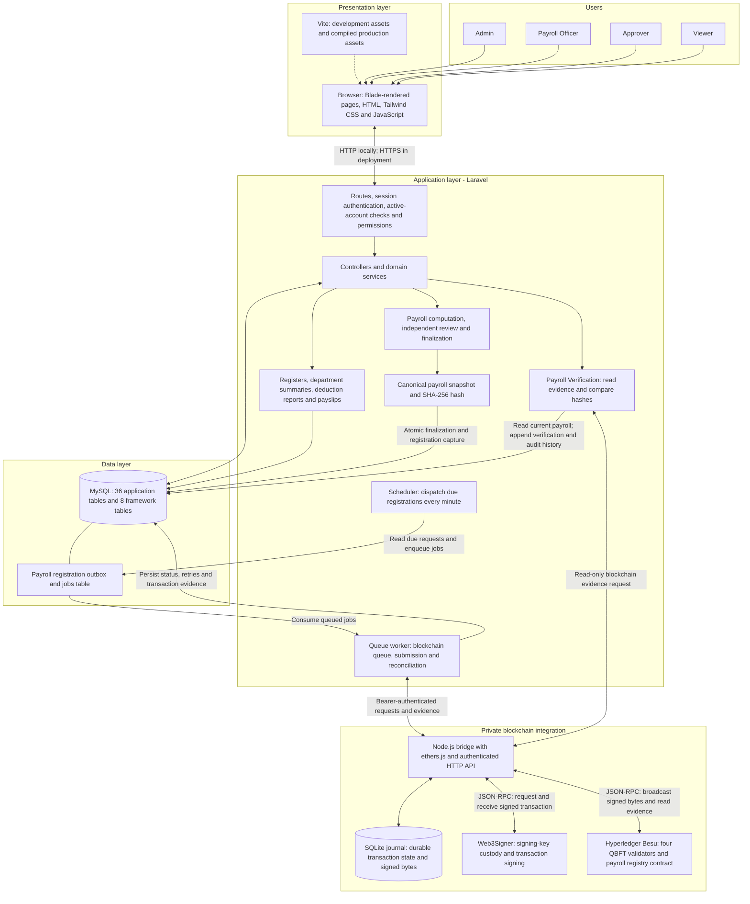
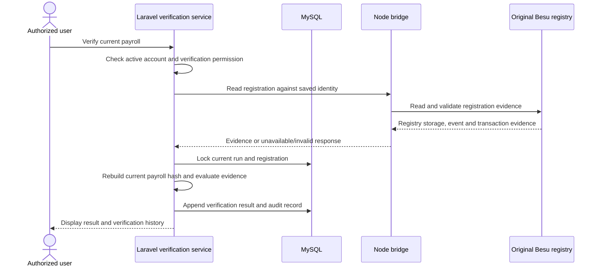

# LGU Payroll Management System - System Architecture

Updated November 11, 2026 to describe the implemented application and its local blockchain integration.

**Architecture:** Three-tier client-server application with asynchronous blockchain-based Payroll Verification.

**Presentation:** Laravel Blade, HTML, Tailwind CSS and native JavaScript.

**Application:** PHP 8.5 / Laravel 13 and a private Node.js integration service.

**Storage:** MySQL for application data; SQLite for the blockchain transaction journal.

**Blockchain:** Hyperledger Besu with four local QBFT validators and Web3Signer.

## 1. Architecture overview



The browser communicates with Laravel. The private bridge, signing service and blockchain RPC endpoints are backend integration components and are not accessed directly by the browser. Solid arrows show runtime data flow; the dotted Vite arrow indicates asset preparation.

## 2. Application responsibilities

| Component / module | Responsibility |
|---|---|
| Authentication and access control | Session login, active-account checks, permission enforcement and role-based navigation. |
| Organization and employee management | Departments, positions, employee profiles, appointments and employment records. Employment types are Permanent, Coterminous and Elective. |
| Compensation management | Salary schedules, salary grades and steps, compensation profiles, approved direct rates and effective dates. |
| Earnings, deductions and statutory configuration | Employee assignments, earning/deduction types, tax brackets and contribution rates. |
| Payroll periods and computation | Coverage dates, approved manual inputs, payable days, earnings, deductions, contributions and take-home pay. |
| Approval and finalization | Submission, independent review, approval, rejection, return for correction and approved-only finalization. |
| Reports and payslips | Payroll register, department summary, deduction totals and employee breakdowns, spreadsheet exports, report printing, payslip generation and publication. |
| Payroll Verification | Captures canonical finalized payroll, coordinates asynchronous registration, validates blockchain evidence and records integrity checks. |
| Audit trail and settings | Records significant actions and maintains organization identity and display settings. |

Separate attendance and leave modules are no longer part of the current application schema or interface. Approved payroll inputs are stored on payroll details as `payable_days`, `input_reference`, `input_recorded_by`, `input_confirmed_at` and `manual_adjustments`.

Laravel enforces authorization and workflow rules even when interface controls are hidden. The preparer or submitter cannot approve, reject or return that same run. Only approved payroll can be finalized, and finalized payroll is locked against normal input editing and recomputation.

## 3. Finalization and asynchronous registration

```mermaid
sequenceDiagram
    actor Approver
    participant App as Laravel application
    participant DB as MySQL
    participant Scheduler
    participant Worker as Blockchain queue worker
    participant Bridge as Node bridge
    participant Journal as SQLite journal
    participant Signer as Web3Signer
    participant Chain as Besu registry

    Approver->>App: Finalize approved payroll
    App->>DB: Begin transaction; lock run and validate status
    App->>App: Build canonical payroll snapshot and SHA-256 hash
    App->>DB: Save finalization, approval/audit entries and QUEUED registration
    App->>DB: Commit transaction
    App-->>Approver: Payroll finalized; registration queued
    Scheduler->>DB: Find due registrations and enqueue jobs
    Worker->>DB: Claim due registration with a lease
    Worker->>Bridge: Validate network and synchronize registration
    Bridge->>Chain: Check existing registration
    opt No existing registration or submission
        Bridge->>Journal: Persist idempotent registration request
        Bridge->>Signer: Request transaction signature
        Signer-->>Bridge: Signed transaction bytes
        Bridge->>Journal: Persist signed bytes and transaction identity
        Bridge->>Chain: Broadcast signed transaction
    end
    Chain->>Chain: Validators confirm registry transaction
    Bridge->>Chain: Read storage, event, receipt and block evidence
    Bridge->>Journal: Persist confirmed transaction state
    Worker->>Bridge: Reconcile on a subsequent due attempt
    Bridge-->>Worker: Validated registration evidence
    Worker->>DB: Save CONFIRMED status and evidence
```

Registry capture is controlled by `PAYROLL_REGISTRY_ENABLED`. When enabled, capture and finalization are saved in the same MySQL transaction. A capture failure rolls back finalization; a later bridge outage leaves the committed request available for retry. Blockchain submission does not run inside the finalization HTTP request.

The bridge processes its durable journal independently. Reconciliation reuses existing evidence or saved signed bytes instead of creating a replacement transaction. Network identity includes the chain, genesis hash, registry contract, runtime-code hash, signer and deployment block. Registration/event checks use bounded block ranges to respect Besu RPC limits.

The dispatcher runs every minute. Worker execution, blockchain confirmation and retry timing are separate stages, so the page can temporarily show QUEUED, SUBMITTED or RECONCILING. A stopped scheduler, worker or bridge can prevent progress; waiting alone will not restore a stopped service.

## 4. Verification request



Verification reads blockchain evidence without resubmitting payroll. It does not require capture to remain enabled or the signer to be available, provided the original registry remains readable through the bridge. Laravel still writes the verification result and audit history locally.

| Verification result | Meaning |
|---|---|
| MATCH | Current payroll and saved registration metadata agree with validated blockchain evidence. |
| MISMATCH | Current payroll or saved registration metadata differs from the registered evidence. |
| PENDING | Registration is still processing; no integrity conclusion is made. |
| UNAVAILABLE | Required services or evidence could not be read; no integrity conclusion is made. |
| NOT REGISTERED | No successful registration was found for the payroll identity and revision. |
| INVALID EVIDENCE | Evidence cannot be validated against the expected registration or supported hash schema. |

A CONFIRMED registration and a MATCH verification are separate findings. A match establishes consistency with a registered version, not calculation accuracy, payment approval or salary transfer.

## 5. Storage boundaries

| Storage | Contents |
|---|---|
| MySQL application tables (36) | Access controls, organization and employees, compensation, payroll snapshots and lines, approvals, payslips, report metadata, settings, audits, versioned registrations and verification logs, plus legacy anchors and their logs. |
| MySQL framework tables (8) | Sessions, password-reset tokens, cache, locks, queued jobs, batches, failed jobs and migration history. |
| Private SQLite journal | Registration requests, reserved transaction state, signed bytes and recovery information for the bridge. It is separate from the MySQL ERD. |
| Besu registry | Organization namespace, opaque payroll reference, revision, payroll hash, hash-schema version and registration metadata. |
| Private application files | Runtime files and protected blockchain configuration/key material; access depends on the service responsible for each file. Frontend build assets are public. |

Employee names, detailed salaries, deductions and the canonical payroll payload stay off-chain. Current master-data changes do not rewrite historical payroll compensation snapshots. Deduction reports use the saved payroll lines, including historical names and amounts. JSON report filters and evidence documents are not additional SQL foreign-key relationships.

The versioned registry is the current finalization integration. Legacy direct anchoring and simulated proofs remain separate for existing records and testing; a simulated proof is not independent blockchain evidence. Registry capture is disabled in the default example environment until configured.

## 6. Default role access

| Role | Responsibilities |
|---|---|
| Admin | Manages users and role assignments, settings, employees and employment records, departments, positions, compensation, earnings, deductions and statutory configuration. Accesses reports, payslips, audit trail and Payroll Verification. The default role cannot prepare, approve or finalize payroll. |
| Payroll Officer | Maintains employee and compensation information, manages payroll periods and approved inputs, computes payroll and submits it for review. Accesses reports, payslips and Payroll Verification. |
| Approver | Independently reviews, approves, rejects or returns payroll and finalizes approved runs. Accesses records, reports, payslips and Payroll Verification. |
| Viewer | Views authorized records and reports. The current `reports.generate` permission also allows spreadsheet exports and payslip generation/publication; it does not allow payroll preparation, approval, finalization or Payroll Verification. |

Users can hold multiple roles. Laravel enforces permissions and reviewer independence regardless of the combined role assignments.

## 7. Runtime and deployment boundaries

- The local development setup runs Laravel, MySQL and the Node bridge alongside Docker containers for four Besu validators and Web3Signer. Laravel's scheduler and blockchain queue worker must also run continuously.
- Vite supplies development assets or compiles assets for deployment. It is not required as a running frontend service once assets are built.
- The bridge listens on loopback and requires bearer authentication. Local Besu and signer RPC ports are bound to loopback; node allowlisting constrains validator connectivity.
- The bridge requests signing and broadcasts signed bytes itself. Web3Signer holds the signing key; it does not replace the durable journal or Laravel's registration outbox.
- Production requires supervised application processes, scheduler and workers, HTTPS, protected signing infrastructure, persistent storage, backups and independently planned validator operations. Four containers on one development computer do not provide host-level fault independence.
- Payroll registration is a background process; an unavailable blockchain does not imply an integrity mismatch. The readiness command checks infrastructure and backlog, while individual verification establishes payroll integrity.

## 8. Technology and companion documents

The implemented stack uses Laravel 13, PHP 8.5, Blade, Tailwind CSS 4, Vite 8, MySQL, Node.js, ethers.js 6.17.0, SQLite, Solidity 0.8.30, Besu 26.10.2 and Web3Signer 26.10.2. See [Software Used](software-used.md) for the verified local inventory and version distinctions.

- [Database schema](database-schema.md): tables, columns, indexes and referential actions.
- [Entity relationship diagrams](erd.md): domain relationships and framework infrastructure.
- [Use case diagram](use-case-diagram.md): actor access and payroll workflow.
- [Blockchain integration](blockchain-anchoring.md): integration and operational details.

Implementation references: `routes/web.php`, `routes/console.php`, `database/seeders/RolePermissionSeeder.php`, `app/Services/PayrollApprovalService.php`, `app/Services/PayrollRegistrationService.php`, `app/Services/PayrollVerificationService.php`, `app/Services/Blockchain`, `config/blockchain.php` and `config/besu/compose.yaml`.
