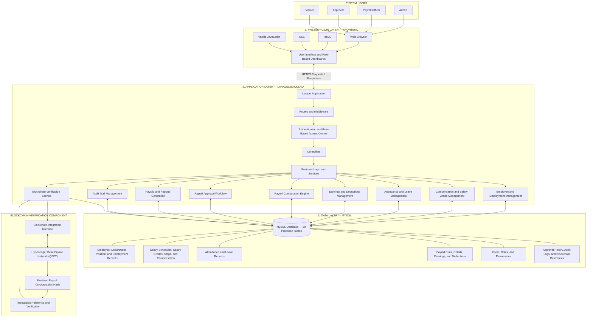

# Proposed System Architecture Diagram
## LGU Payroll Management System

**Architecture:** Three-Tier Client-Server Architecture with Integrated Blockchain-Based Payroll Verification  
**Frontend:** HTML, CSS, Vanilla JavaScript  
**Backend:** PHP / Laravel  
**Database:** MySQL  
**Users:** Admin, Payroll Officer, Approver, and Viewer

---

## 1. System Architecture Diagram

The diagram shows how the four system roles access the frontend, how Laravel processes requests and enforces business rules, how MySQL stores the system's operational data, and how the blockchain component verifies finalized payroll records.

---

## 2. Description of the Architectural Layers

### A. Presentation Layer — Frontend

The Presentation Layer provides the web interface through which authorized users interact with the system using a web browser.

**Technologies:**
- **HTML:** Structures the web pages and forms.
- **CSS:** Controls the layout and visual presentation.
- **Vanilla JavaScript:** Handles client-side interactions and interface behavior.

The interface presents functions according to the user's role. The frontend may hide unavailable actions for usability, but access restrictions must also be enforced by the Laravel backend.

### B. Application Layer — Laravel Backend

The Application Layer processes requests, applies business rules, validates data, enforces permissions, and coordinates communication with MySQL and the blockchain integration component.

**Main services and modules:**

| Module | Responsibility |
|---|---|
| Authentication and RBAC | Authenticates users and enforces role-based permissions. |
| Employee and Employment Management | Manages employee profiles, appointments, departments, and positions. |
| Compensation Management | Retrieves the applicable salary schedule, salary grade, step, and compensation rate. |
| Attendance and Leave Management | Records attendance by days and manages leave records. |
| Earnings and Deductions Management | Supports configured earnings and applicable deductions, including manually entered amounts. |
| Payroll Computation Engine | Calculates basic pay, total compensation, deductions, and net take-home pay using configured rules. |
| Payroll Approval Workflow | Routes submitted payroll for independent review, approval, rejection, or return for correction. |
| Payslip and Reports Generation | Generates payslips and authorized payroll reports. |
| Audit Trail Management | Records important user actions and changes. |
| Blockchain Verification Service | Generates payroll hashes and coordinates anchoring and verification. |

**Separation of duties:** The Payroll Officer who prepares and submits a payroll run must not approve that same run. Laravel must enforce this restriction even if an Admin has broad system privileges.

### C. Data Layer — MySQL

MySQL is the system's primary database. It stores employee and employment information, organizational records, salary schedules, attendance, leave, payroll computations, approval history, user access records, audit logs, and blockchain transaction references.

The current proposed database design contains **39 tables**. Actual employee information, salary amounts, deductions, and payslip contents remain in MySQL rather than being placed directly on the blockchain.

### D. Blockchain Verification Component

The blockchain component provides an additional method for checking whether finalized payroll data has changed after it was anchored.

**Proposed process:**
1. The Payroll Officer prepares and submits the payroll run.
2. A different authorized Approver reviews and approves it.
3. The approved payroll is finalized.
4. The application creates a deterministic representation of the finalized payroll data and calculates its cryptographic hash.
5. The hash is submitted to the selected blockchain network.
6. The application stores the transaction reference and related metadata in MySQL.
7. During verification, the application recalculates the hash and compares it with the anchored hash.

Only the cryptographic proof and necessary transaction metadata should be placed on-chain. Do not place employee names, personal identifiers, salary details, deductions, or payslip contents directly on a public blockchain.

---

## 3. User Roles and Main Responsibilities

| Role | Main responsibilities |
|---|---|
| **Admin** | Manages user accounts, roles, permissions, and authorized system configurations. Administrative access does not bypass payroll approval controls. |
| **Payroll Officer** | Manages authorized employee and payroll information, records attendance and allowances, enters applicable deductions, computes payroll, and submits it for approval. |
| **Approver** | Independently reviews submitted payroll and approves, rejects, or returns it for correction. |
| **Viewer** | Views only the employee, payroll, and report information authorized for the role. |

---

## 4. Technology Stack

| System component | Proposed technology |
|---|---|
| Frontend | HTML, CSS, Vanilla JavaScript |
| Backend | PHP with Laravel |
| Database | MySQL |
| Communication | HTTP/HTTPS; use HTTPS in deployment |
| Access control | Authentication and Role-Based Access Control (RBAC) |
| Blockchain | Hyperledger Besu 26.10.2 local private network with four QBFT validators and node allowlisting; Solidity anchoring contract; Web3Signer 26.10.2 signs and submits transactions |

---

## 5. Mock Defense Explanation

The proposed LGU Payroll Management System adopts a **Three-Tier Client-Server Architecture with Integrated Blockchain-Based Payroll Verification**. The Presentation Layer uses HTML, CSS, and Vanilla JavaScript to provide the user interface for the Admin, Payroll Officer, Approver, and Viewer. The Application Layer uses Laravel to handle authentication, role-based access control, employee management, compensation, attendance, payroll computation, approval workflows, reports, and audit logging. The Data Layer uses MySQL as the primary database for storing employee information, salary schedules, attendance, payroll transactions, and related records. A separate blockchain integration component anchors a cryptographic hash of finalized payroll data so that authorized users can verify the integrity of the anchored record. Confidential employee and payroll information remains in the MySQL database.

---

## 6. Implementation Notes

- This is the **proposed architecture** for the capstone and should be updated if the selected hosting environment, blockchain network, or deployment design changes.
- Hyperledger Besu is the selected blockchain platform. Local Docker integration uses four QBFT validators, a Solidity anchoring contract, and Web3Signer through JSON-RPC. The local application is configured for Besu; fresh checkouts and normal QA retain simulated anchoring until configured. Production operations remain pending.
- Use HTTPS in the deployed system.
- Enforce permissions and separation of duties on the Laravel backend, not only in the frontend.
- Generate blockchain hashes only from finalized payroll data using a consistent, deterministic serialization process.
- Keep the applicable tax, contribution, salary schedule, and payroll computation rules configurable and subject to client and official-guidance validation.
