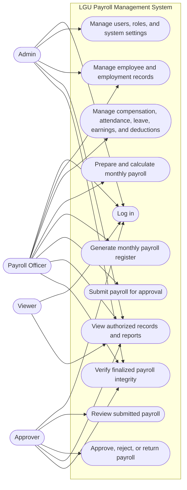
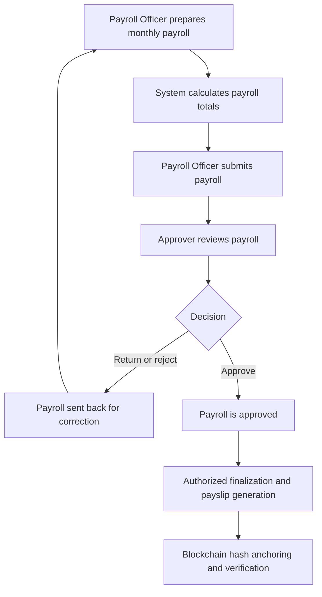

# LGU Payroll Management System
## Simplified Use Case Diagram

This simplified diagram shows the main activities of the four system roles. Detailed sub-tasks are grouped so the diagram is easier to understand during the mock defense.

## Role responsibilities

| Role | Main responsibilities |
|---|---|
| **Admin** | Manages users, roles, system settings, and authorized master records; can view reports and audit-related information. |
| **Payroll Officer** | Manages employee and payroll information, enters monthly allowances and manual deductions, records attendance and leave, prepares payroll, generates the register, and submits it for approval. |
| **Approver** | Independently reviews submitted payroll and approves, rejects, or returns it for correction. |
| **Viewer** | Views only the employee, payroll, and report information permitted by assigned access. |

## Main payroll approval flow

## Important business rule

The Payroll Officer who prepares and submits a payroll run must not approve that same payroll run. Enforce this separation of duties in the Laravel backend, not only by hiding or showing interface buttons. Only approved payroll may proceed to finalization.

## Notes

- All four roles must authenticate before accessing protected features.
- The Viewer role is read-only and must only see authorized information.
- Allowances and the client's specified manual deductions are entered by the Payroll Officer during monthly payroll preparation.
- Attendance is recorded by days, not hours.
- Salary grade and step determine the basic salary through the LGU-adopted salary schedule.
- Blockchain verification applies to finalized payroll data; confidential employee and payroll details remain in MySQL.
- This is a simplified, proposed use case model. Confirm the exact Admin permissions, report access, finalization responsibility, and blockchain verification access with the client before implementation.
