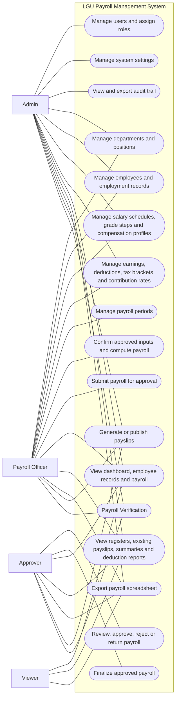
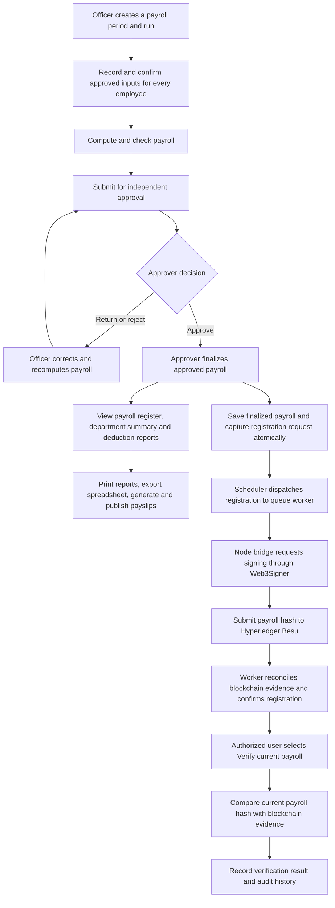

# LGU Payroll Management System

## Use case diagram

This diagram reflects the implemented routes and default role permissions. Ovals represent use cases; lines connect each role to its available actions. All protected actions require login and an active account. Users with multiple roles receive their combined permissions, subject to independent-review rules.

## Role responsibilities

| Role | Implemented responsibilities |
|---|---|
| **Admin** | Manages users, role assignments, settings, organization records, employees, compensation and payroll reference data. Views and exports the audit trail, accesses reports and payslips, and verifies payroll. The default Admin role cannot prepare, approve or finalize payroll. |
| **Payroll Officer** | Maintains organization and employee records, compensation, earnings, deductions and statutory configuration. Manages payroll periods, confirms approved inputs, computes payroll and submits it for independent approval. Accesses reports, payslips and Payroll Verification. |
| **Approver** | Reviews submitted payroll; approves, rejects or returns it for correction; and finalizes approved payroll. Views records, accesses reports and payslips, and verifies payroll. |
| **Viewer** | Views employee and payroll records, existing payslips, registers, department summaries and deduction reports. Exports spreadsheets through `reports.export`. Cannot generate/publish payslips, edit payroll inputs, approve or finalize payroll, or use Payroll Verification. |

## Payroll and verification workflow

## Included report and configuration features

- **Employment records:** Permanent, Coterminous and Elective employment types.
- **Compensation:** salary schedules, salary grade steps and employee compensation profiles.
- **Payroll inputs:** approved payable days and supporting references, earnings and deductions. Attendance and leave management are not separate screens in the current interface.
- **Deduction reports:** totals by deduction type, employee breakdowns, selection of an individual deduction and printing. Reports use saved payroll names and amounts, including inactive deduction types recorded in that payroll.
- **Payroll reports:** register, department summary, spreadsheet export and payslips. Reports for payroll that is not finalized display a working-copy notice.
- **Payroll Verification:** displays registration status and records a fresh integrity check when an authorized user requests verification.

## Business and integrity rules

- The preparer or submitter cannot approve, reject or return that same payroll run, even when assigned multiple roles.
- Only approved payroll can be finalized. Finalized payroll is locked against normal input editing and recomputation.
- With registry capture enabled, finalization saves the payroll and registration request in one database transaction. Blockchain submission and confirmation occur asynchronously.
- A confirmed registration and a verification result are separate states. Verification returns **MATCH**, **MISMATCH**, **PENDING**, **UNAVAILABLE**, **NOT REGISTERED** or **INVALID EVIDENCE**.
- Verification compares saved payroll values with the registered hash. Changes to current compensation profiles or salary schedules do not rewrite the compensation snapshots in an existing finalized payroll.
- Confidential employee and payroll details remain in MySQL. Besu stores an opaque payroll reference, revision, SHA-256 hash and supporting metadata.
- A match establishes consistency with the registered payroll version; it does not certify calculation accuracy or release salary payments.

Implementation references: `routes/web.php`, `database/seeders/RolePermissionSeeder.php`, `app/Services/PayrollApprovalService.php`, `app/Services/PayrollRegistrationService.php` and `app/Services/PayrollVerificationService.php`.
